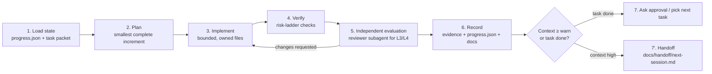

# Harness of Harnesses: the Outer Control Loop

Every tool (Claude Code, Codex, Cursor) has its own inner loop (plan → tool calls → answer). This document defines the **outer loop** that stays the same across tools and sessions, so work survives context resets and tool switches.

## The steps

1. **Load state.** Read `AGENTS.md` (always loaded), then `progress.json`, then the task packet in `docs/delivery/tasks/`. Read only the doc sections the packet links to. **Never** reconstruct state from chat history; if the repository disagrees with `progress.json`, trust the repository (`git log`, `git status`) and fix `progress.json`.
2. **Plan.** Restate the acceptance criteria. Identify the ladder level ([testing strategy](../testing/strategy.md#risk-ladder-choose-the-level-per-change)). List every place the change must reach (callers, tests, fixtures, docs).
3. **Implement.** Within the packet's file ownership. Prefer existing code, the platform, installed dependencies. Ask for approval before any new runtime dependency.
4. **Verify.** Run the required checks for the level. Long runs go in the background; wait for completion and read the exit code.
5. **Independent evaluation.** L3 and L4: `reviewer` (and `security-reviewer` for auth, files or DTO changes) in a fresh context, given only the packet, the diff and the checklist. L1 and L2: the orchestrator self-reviews against the checklist.
6. **Record.** Append evidence and update `progress.json` (`current_task`, `completed`, `changed_files`, `tests`, `decisions`, `risks`, `next_task`, `last_updated`). Update the docs the change affects in the same branch.
7. **Close.** Ask the Lead Coordinator for merge approval, or hand off.

## Separation of mechanisms (use the right one)

| Mechanism | Purpose here | Location |
|---|---|---|
| **Project rules** (always loaded, short) | Invariants + navigation | `AGENTS.md` (all tools), `CLAUDE.md` (imports AGENTS.md + Claude-specific notes) |
| **Reference docs** (on demand) | Detailed design and procedures | `docs/**` |
| **Skills** (reusable procedures, loaded when invoked) | `handoff`, `verify-change`, `new-adr` | `.claude/skills/*/SKILL.md` |
| **Subagents** (isolated context) | Research, specialist implementation, independent review | `.claude/agents/*.md` |
| **Hooks** (deterministic guards, no judgment) | Block destructive git commands, direct commits to protected branches, and edits to real `.env` files | `.claude/settings.json` → `.claude/hooks/guard.mjs` |
| **CI** (the final, tool-independent gate) | Build, tests, scans | `.github/workflows/*` |

Hooks are a safety net, not the only control: CI and branch protection enforce the same rules on the server side.

## Hooks
`PreToolUse` on `Bash|PowerShell` and `Edit|Write`. The script is `node .claude/hooks/guard.mjs` (Node is a project prerequisite, so it works on every OS). It blocks with exit code 2 and a reason:
- `git push --force` / `-f` / `--force-with-lease`, `git reset --hard`, `git clean -f…`, `git branch -D`, `git checkout -- .`/`git restore .` (discarding work), `rm -rf` on paths outside `bin/obj/node_modules/dist/.data`
- `git commit` / `git merge` while the current branch is `master` or `develop` (merges happen through PRs after approval)
- `Edit`/`Write` to `.env` or `.env.*` other than `.env.example`

Tests: `node --test ".claude/hooks/*.test.mjs"` (6 tests, passing on 2026-10-17; added to CI in T-003). Hooks are loaded from `.claude/settings.json` when a session starts. Check them with `/hooks` in an interactive `claude` terminal.

## Context budget and handoff

- **Measure, don't guess.** Claude Code exposes `context_window.used_percentage` to the status line (an optional statusline script can display it). Codex and Cursor show their own indicators in the UI. Where no reliable indicator exists, assume high usage after about 40 tool calls or about 25 large file reads and hand off early.
- Thresholds (configurable in `progress.json` → `policy.context`): **warn at 70 %**, **stop at 80 %**.
- At **warn**: finish the smallest safe unit (never stop mid-edit with a broken build if it can be avoided), commit on the feature branch, then run the **`handoff` skill** ([handoff.md](handoff.md)).
- At **stop**: no new work. Only record state and hand off.
- Keep always-loaded files small (`AGENTS.md` ≤ 150 lines; Codex's default combined limit is 32 KiB). Never paste logs, transcripts or whole docs into prompts. Reference paths instead.

## Evaluation protocol for agent work

Measure the process, not just the product, at each milestone gate. Record it in `docs/delivery/evidence/<milestone>.md`:

| Metric | How |
|---|---|
| First-pass acceptance | Share of tasks whose first review verdict was APPROVE |
| Escaped defects | Bugs found after merge that existed in a reviewed change |
| Claim accuracy | Subagent claims (tests passed, files changed) contradicted by orchestrator verification |
| Rework | Commits per task after the first review |
| Cost signal | Sessions per task, handoffs per task (from `progress.json` history) |

If claim accuracy drops or rework rises, tighten the packets (smaller scope, more explicit acceptance criteria) before adding more agents.
