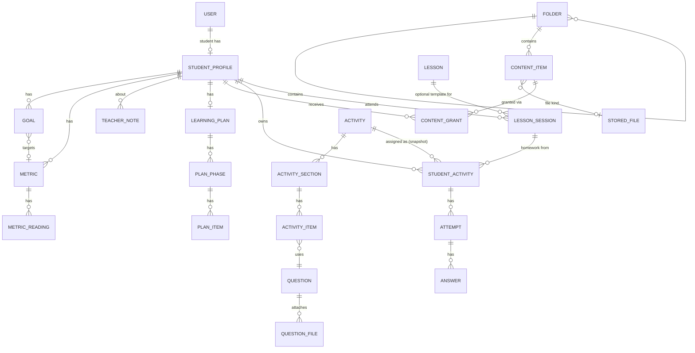
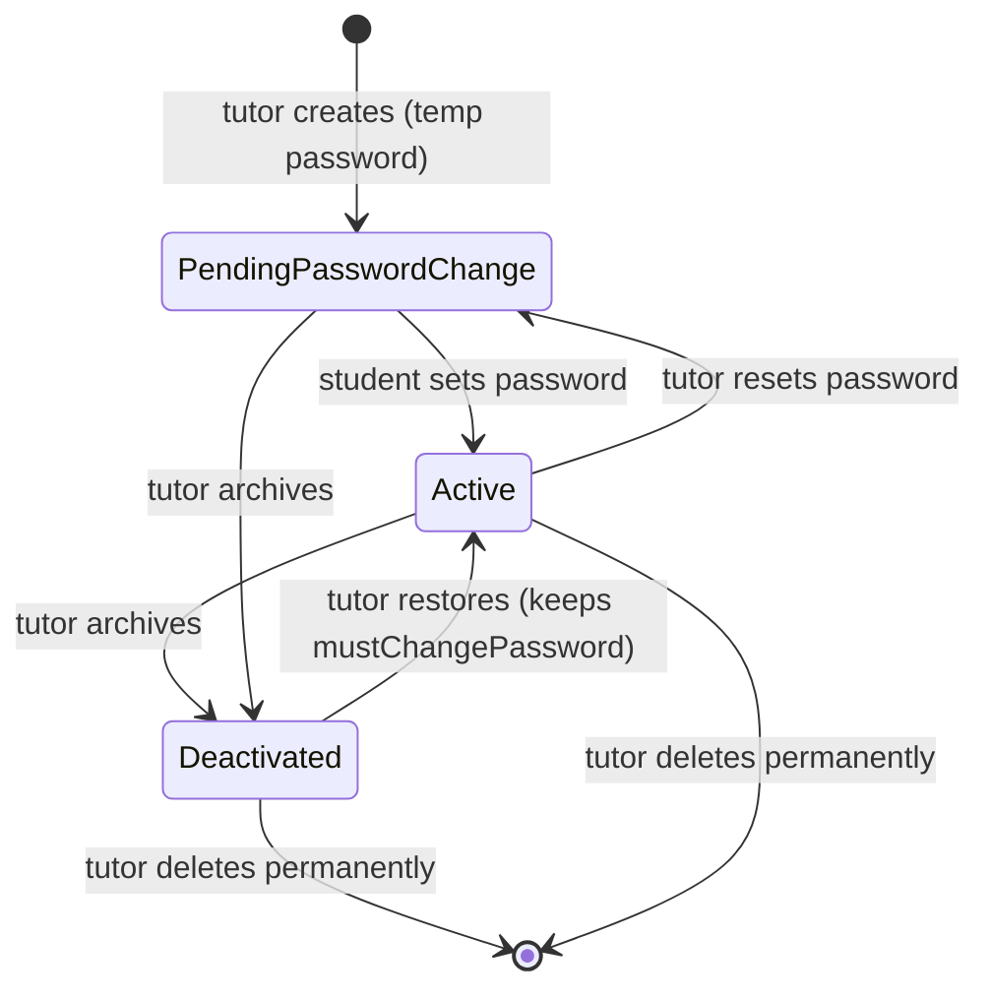
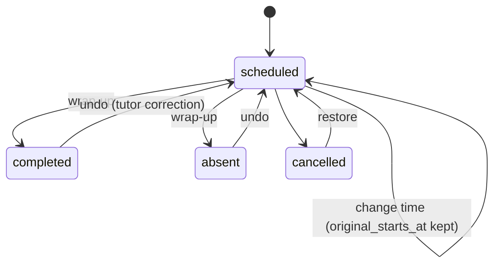
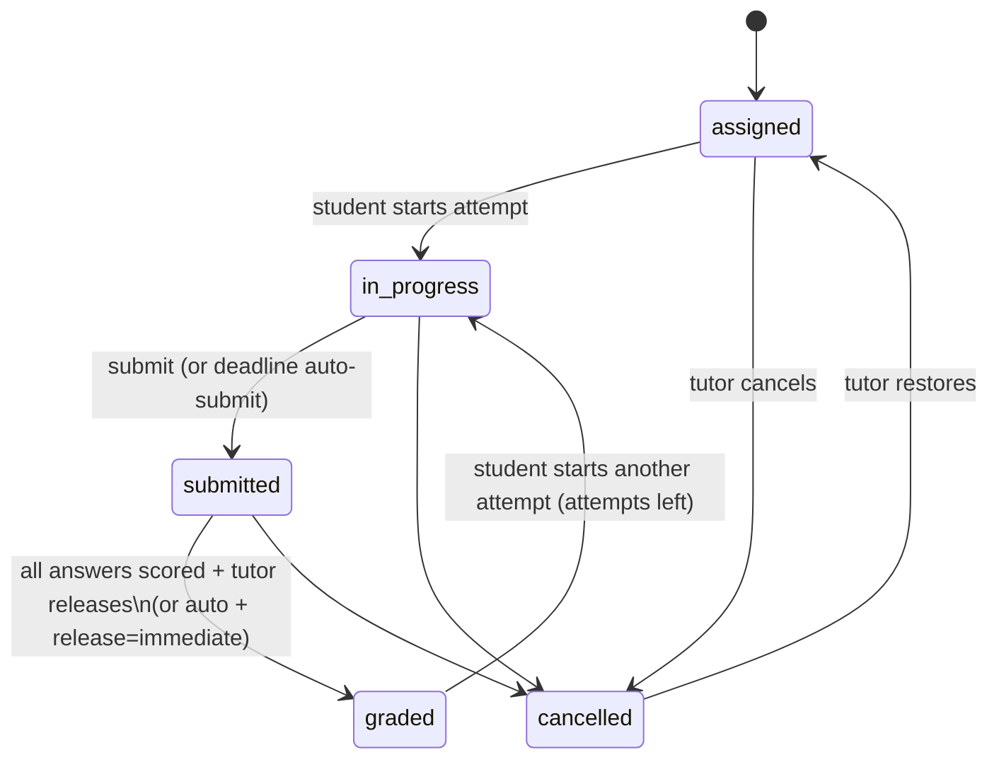

# Domain Model

This revises the entity direction in §34 ("not the final schema"). Physical tables: [database.md](database.md).

## Vocabulary (use these words in code and UI)

| Term | Meaning | Spec term |
|---|---|---|
| **Student** | A user with role `student` plus a `StudentProfile` | Student |
| **Content item** | A reusable library entry: file, rich text, link or embed | Content item, Material |
| **Grant** | The fact that a student may see a content item, with the source of that permission | "material granted to me" (§26) |
| **Lesson** | A reusable lesson plan (template) | Lesson (builder, §14) |
| **Session** | A scheduled 1:1 meeting with one student | Lesson session (§22) |
| **Question** | A bank entry of one of the 7 types | Question |
| **Activity** | A reusable assignment or assessment definition | Assignment, Assessment |
| **Student activity** | One activity assigned to one student, with a snapshot | Student Activity (§15) |
| **Attempt** | One try at a student activity | Attempt, Submission |
| **Answer** | The response to one snapshot item within an attempt | Answer |
| **Feedback** | Comment + rubric criteria on an attempt, plus per-answer comments | Feedback |
| **Metric** | A tutor-defined measurable quantity for one student | LearningMetric |
| **Reading** | One value of a metric at a point in time | ProgressRecord (§34, replaced by ADR-0015) |
| **Goal** | A student objective, optionally targeting a metric value | LearningGoal |
| **Plan / Phase / Plan item** | A student's optional learning plan and its structure | LearningPlan, LearningPlanItem |
| **Private note** | A tutor-only note about a student | TeacherNote |

## Aggregates and ownership

| Aggregate root | Contains | Owner | Student-scoped? |
|---|---|---|---|
| User | credentials, role, preferences | Identity | the student's own user |
| StudentProfile | contacts, parents, learning profile, custom fields | Students | yes (`student_id = user_id`) |
| Goal | — | Students | yes |
| Metric | readings | Students | yes |
| TeacherNote | — | Students | yes, **tutor-only visibility** |
| Folder | — | Content | no (library) |
| ContentItem | file reference | Content | no; visible to a student only via a grant |
| ContentGrant | — | Content | yes |
| Question | files | QuestionBank | no |
| Activity | sections, items, materials | Activities | no |
| StudentActivity | snapshot, attempts, answers, feedback | Activities | yes |
| Lesson | materials, suggested activities | Lessons | no |
| LessonSession | session materials | Lessons | yes |
| LearningPlan | phases, items | LearningPlans | yes |

**The library vs student split (§15, §32) is the main structural rule.** The library side (Folder, ContentItem, Question, Activity, Lesson) never holds a `student_id`. The student side always does, and every student-facing query filters on it.

## Lifecycles

### Student account

Stored as `users.is_active` + `users.must_change_password`. "Archived" in the UI = deactivated.

### Goal
`active ⇄ paused`, `active → achieved`, `active|paused → dropped`. Any state can return to `active` (the tutor changed their mind). `achieved_at` is set on entering `achieved` and cleared on leaving it.

### Lesson session

Corrections are allowed because the tutor is trusted and mistakes are common. Changes are not audited beyond `updated_at` (attendance has no legal weight here).

### Student activity and attempt

- **Overdue** is derived (`due_at < now` and status ∈ {assigned, in_progress}), never stored.
- **Available-from**: before `available_from`, the student sees the task as "opens on …" and cannot start it.
- Attempt states: `in_progress → submitted → graded`. At most **one** `in_progress` attempt per student activity (partial unique index).
- Score of a student activity = its best graded attempt (PD-13). It is recomputed when any attempt is graded or regraded.
- **Regrading** after release is allowed. The student sees the updated score, and `graded_at` is updated.

### Learning plan
Phase: `planned → active → done`, with `paused` reachable from any state and the ability to return. Item: `todo → in_progress → done | skipped`, with `paused` available. Statuses are **set by the tutor**. An item linked to a student activity shows that activity's status as a hint but is not auto-completed (§2: the tool must not impose a workflow).

## Visibility matrix (what a student can see)

| Data | Tutor | Owning student | Other students |
|---|---|---|---|
| Profile: name, contacts | ✅ | ✅ own name and language only (contacts and parents are tutor-only) | ❌ |
| Learning profile (level, strengths, weaknesses, notes, custom fields) | ✅ | ❌ (tutor's working data) | ❌ |
| Goals, metrics, readings | ✅ | ✅ | ❌ |
| Private notes, session preparation notes | ✅ | ❌ | ❌ |
| Session time, mode, link, summary, materials, homework | ✅ | ✅ | ❌ |
| Learning plan | ✅ edit | ✅ read-only | ❌ |
| Library content | ✅ | only via grants | ❌ |
| Snapshot answer keys and explanations | ✅ | only after release, if `show_answers = after_grading` | ❌ |
| Attempts, answers, files, scores, feedback | ✅ | ✅ own (scores and feedback after release) | ❌ |

Note: hiding the learning profile from the student is a **proposal** (strengths and weaknesses are often frank working notes). If the tutor wants students to see their level, add a per-field "visible to student" flag in a later milestone. Logged as a review point in M2.

## Invariants (enforced in code and/or DB)

1. Exactly one user with `role = tutor` (partial unique index).
2. Every student-scoped row has a non-null `student_id` that references a student user.
3. A `student_activity.snapshot` never changes after creation. Corrections happen by cancelling and reassigning.
4. An answer belongs to an attempt of the same student activity, and its `item_key` exists in the snapshot.
5. A content item is downloadable by a student only if a grant row exists for that student **or** its file is referenced by the student's own snapshot or answers.
6. A question or activity referenced by an assignment cannot be hard-deleted, only archived.
7. Folder names are unique per parent (case-insensitive), and folders cannot form cycles (checked on move).
