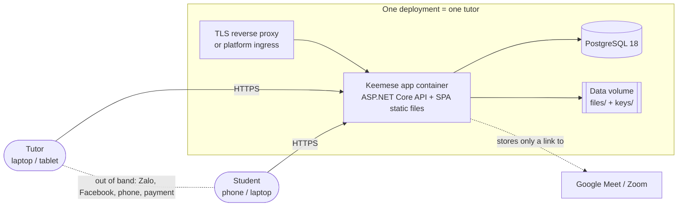
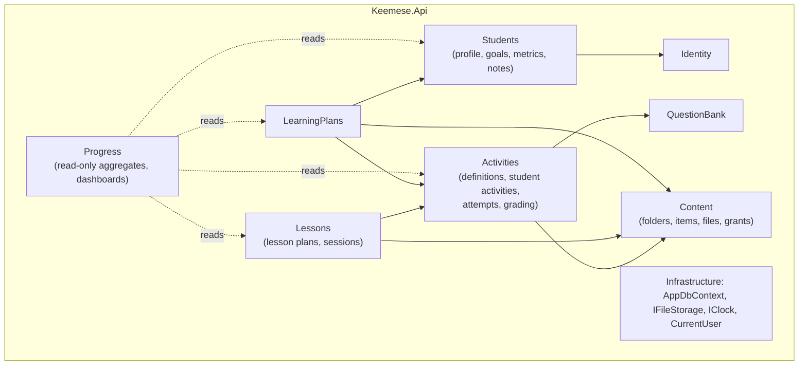

# Architecture Overview

Decisions referenced: ADR-0002 (modular monolith), 0003 (PostgreSQL), 0004 (cookie auth), 0005 (SPA served by the API), 0007 (files).

## System context

Nothing else: no queue, cache, search engine, object store or background worker (§36). Every addition needs an ADR with a business reason.

## Containers and runtime

| Piece | Tech | Notes |
|---|---|---|
| App | ASP.NET Core (.NET 10) on Kestrel | Serves `/api/**`, `/openapi/**` (development only), `/health`, and the SPA `index.html` fallback |
| SPA | React 19 + Vite 8 build output | Copied into the image under `wwwroot` |
| Database | PostgreSQL 18 | EF Core migrations are applied at startup by default (one instance); a CLI flag allows applying them manually |
| Volume | `DATA_DIR` (default `/data`) | `files/` for uploads, `keys/` for Data Protection keys |

**Background work:** none in MVP. Time-based behavior (overdue tasks, attempts that ran past their deadline) is evaluated *lazily* at read and write time, not by a scheduler.

## Modules

Arrows mean "calls the `Contracts` of". Notes on the less obvious dependencies:
- Lessons → Activities: the wrap-up step assigns homework.
- LearningPlans → Students: plan items link to goals.

`Progress` reads across modules **by query only** (it has no write access), which is the one sanctioned cross-module read path (ADR-0015).

| Module | Owns (tables) | Exposes (`Contracts`) |
|---|---|---|
| Identity | `users` (+ Identity token/claim tables), `audit_events` | `ICurrentUser`, `IAccountService` (create student login, reset, deactivate) |
| Students | `student_profiles`, `goals`, `metrics`, `metric_readings`, `teacher_notes` | `IStudentDirectory` (exists/active, display name), `IMetricRecorder` |
| Content | `folders`, `content_items`, `stored_files`, `content_grants` | `IContentGrants` (grant/revoke by source, can-access), `IFileService` |
| QuestionBank | `questions`, `question_files` | `IQuestionReader` (fetch for snapshot) |
| Activities | `activities`, `activity_sections`, `activity_items`, `activity_materials`, `student_activities`, `attempts`, `answers`, `answer_files` | `IActivityAssigner` (assign, used by Lessons wrap-up), `IStudentActivityReader` |
| Lessons | `lessons`, `lesson_materials`, `lesson_activities`, `lesson_sessions`, `session_materials` | `ISessionReader` |
| LearningPlans | `learning_plans`, `plan_phases`, `plan_items` | — |
| Progress | none | Dashboard and progress queries |

## Request pipeline (order matters)

1. Forwarded headers (only from configured proxies), HTTPS redirect / HSTS (outside development)
2. Security headers (CSP, `X-Content-Type-Options`, `Referrer-Policy`, `frame-ancestors 'none'`)
3. Static files (SPA assets)
4. Authentication (Identity cookie) → Authorization (fallback policy = authenticated)
5. **Must-change-password gate** (FR-AUTH-AC5)
6. Antiforgery validation on unsafe methods
7. Rate limiting (login and upload endpoints)
8. Endpoint groups → module services → `AppDbContext`
9. Exception handler → ProblemDetails (with a `traceId`)

## Cross-cutting

| Concern | Approach |
|---|---|
| IDs | UUID v7 (`Guid.CreateVersion7()`), generated by the app |
| Time | `IClock` / `TimeProvider`. Stored as `timestamptz` UTC. Displayed in the viewer's browser time zone |
| Audit fields | `created_at` / `updated_at` set by a `SaveChanges` interceptor. Security events go in `audit_events` |
| Concurrency | `xmin` concurrency token on editable aggregates → `409 concurrency.conflict` |
| Logging | Built-in `ILogger`, structured console output (JSON in production). **No PII, passwords, tokens or answer content in logs** |
| Health | `/health/live` (process) and `/health/ready` (database reachable, data directory writable) |
| Config | `appsettings.json` defaults + environment variables (`ConnectionStrings__Db`, `DATA_DIR`, `BOOTSTRAP_TUTOR_*`, `Uploads__*`). Secrets come only from the environment |

## Related
- [Domain model](domain-model.md) · [Database](database.md) · [API](api.md) · [Backend conventions](../backend/conventions.md) · [Security model](../security/security-model.md)
