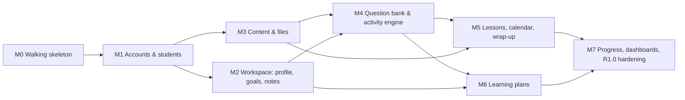

# Milestones and Task Dependencies

Each milestone ends in a **gate** ([quality gates](../testing/strategy.md#quality-gates)) and a usable increment. Tasks are cut into packets of about ½–1 day of agent work (`docs/delivery/tasks/T-*.md`). The packets for the current milestone are written up front; later milestones get theirs written when the previous gate closes, so they reflect what was learned.

M2 and M3 can run in parallel (disjoint modules) once M1 lands. Everything else is sequential: activities need content (attachments) and goals (metric recording), and the wrap-up needs activities (homework).

| M | Goal | Requirements | Exit criteria (beyond the standard gate) |
|---|---|---|---|
| **M0** | Walking skeleton: repo builds and tests on every OS, the stack runs, CI is green | NFR-PORT-01, NFR-SEC-04, ADR-0012/13/16 | `dotnet build`/`test`, `npm` lint/typecheck/test/build pass locally (Windows) and in CI (Linux) · Compose `db` + `--profile app` start · `/health/ready` 200 · SPA shell served same-origin · i18n wired (vi/en) with the parity test · design tokens file · `.env.example` · Dependabot · guard-hook tests in CI |
| **M1** | Tutor and student can log in; tutor manages student accounts (navigation per PD-08, formerly OD-09, decided 2026-10-23) | FR-AUTH-01..08, FR-STU-01..03, -05..07, FR-UX-01, FR-DASH-01/02 (shells) | J2 ≤ 2 interactions · forced password change · lockout · isolation suite + authz enumeration test in place (even with few endpoints) · `E2E-AUTH`, `E2E-J2`, `E2E-ISO` · AppShell (tutor and student) at 4 widths · tutor-password reset CLI |
| **M2** | Student workspace: learning profile, goals, metrics, private notes | FR-STU-04, FR-GOAL-01..04 (manual), FR-NOTE-01..03 | Notes absent from all `/api/me` responses (suite) · goal % math unit-tested · workspace Overview and Profile tabs pass visual QA · **review point:** learning-profile visibility to students (domain model note) |
| **M3** | Content library and secure files | FR-CONT-01..08 | OD-03 and OD-05 decided first (rich text spike) · upload allowlist + sniffing tests · file access rules tested for all 4 student paths · student Materials page |
| **M4** | Question bank + activity engine (assignments and assessments) | FR-QB-01..05, FR-ACT-01..14, FR-GOAL-04 (from results) | Every question type has grading + redaction unit tests · snapshot immutability test · time limit and lazy expiry tests · `E2E-J4J5`, `E2E-J3`, J9 · Review queue |
| **M5** | Lessons, sessions, calendar, the after-lesson wrap-up | FR-LES-01..07 (+ OD-01 if approved) | **J1 ≤ 7 interactions, verified in E2E-J1 with an interaction count** · wrap-up transaction rollback test · time-zone display tests |
| **M6** | Learning plans | FR-PLAN-01..05 | Keyboard reordering works · student read-only view · plan independence test |
| **M7** | Progress, dashboards, release hardening → **v1.0.0** | FR-PROG-01..03, FR-GOAL-05, FR-DASH-01/02 (complete), NFR-PERF-01, NFR-OPS-01 | Progress math tests incl. zero-data · dashboard answers §55 without scrolling at 1440×900 · full E2E on 3 browsers · compat workflow green · ASVS L1 pass · backup/restore drill · OD-06 decided · release notes |

M1 packets: T-101…T-110 ([task index](tasks/README.md#index)), approved by the Lead Coordinator on 2026-10-23.

## Phase 2 backlog (not scheduled; from the scope doc)
Learning plan templates (PD-01) · notifications (PD-02) · vocabulary (PD-03) · matching, ordering and audio-recording question types (PD-04) · versioning (PD-05) · annotation feedback (PD-06) · email password reset (PD-07) · recurring lessons · analytics. Each needs a product decision before it gets a packet.

## Recommended first increment

**M0, walking skeleton**, in three packets that can be reviewed one at a time:
1. [T-001](tasks/T-001-backend-skeleton.md): backend solution, health endpoints, PostgreSQL via Compose, first migration, test projects (unit + Testcontainers integration).
2. [T-002](tasks/T-002-frontend-skeleton.md): Vite/React/TS SPA with TanStack Router, Query, Tailwind v4 tokens, i18n (vi/en) and parity test, served by the API.
3. [T-003](tasks/T-003-ci-and-repo-automation.md): GitHub Actions `ci.yml`, Dependabot, guard-hook tests in CI, secret scan.

T-001 → T-002 → T-003 run in sequence: T-002 needs the API to serve the SPA, and T-003 needs both to have something to build. T-003's workflow file can be drafted while T-002 is in review, but it can only be proven on GitHub, so it needs the remote repository (see below).

**Prerequisite (owner action):** create the public GitHub repository and approve the initial push of `master` and `develop` (PD-10). Until then, CI can't run, and evidence stays local.
